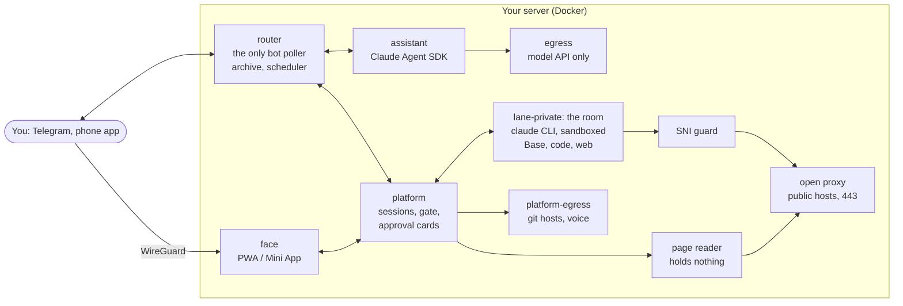

# Retinue

**One interface to everything you do with an AI agent, on your own server.** Your work, research, mail, plans and notes run on one Linux box, and you steer them from a phone, a browser or Telegram. Nothing depends on a laptop staying open or on one vendor's app

Retinue has two halves:

- **An assistant in Telegram and in the app.** She reads your conversation archive, your mail and your knowledge base. Her container reaches the model API and nothing else
- **Claude Code sessions in one sandboxed container.** An unmodified, version-pinned `claude` CLI runs headless in auto mode, with your knowledge base, your repositories and the web. Every tool call passes a gate, and whatever would leave the server comes to you as a card

> **Status: personal pilot.** It runs every day on one server, for one person. There is no multi-user mode and no hosted version, and breaking changes land on `main` without notice. Read it, borrow from it, or run it for yourself if the model below fits you

## Contents

- [Why it exists](#why-it-exists)
- [What works today](#what-works-today)
- [How it works](#how-it-works)
- [Security model](#security-model)
- [Quick start](#quick-start)
- [Where it is going](#where-it-is-going)
- [Model access](#model-access)
- [Limits and known gaps](#limits-and-known-gaps)
- [Repository layout](#repository-layout)
- [Language](#language)
- [Contributing, security, license](#contributing-security-license)

## Why it exists

I want every process I run with an agent to live on a server I own, tied to no laptop, no phone and no single provider. Claude Code is the engine while it is the best one. The processes, the memory, the rules, the skills and the interface stay mine, in open formats where they exist: `AGENTS.md`, MCP, Agent Skills

A feature earns its place by the app it lets me stop opening, and protection gets built for a feature I actually use. The code is public. What you fill it with stays on your server and in your own git hub, and reaches the model provider when a turn reads it

Three rules run through the code:

- **Limits live in the system.** Each one is a network, a hook or a test, and the model has no say in whether it applies
- **Undo before a question.** What can be taken back just happens, and you get one line and «Undo». A button stands only where nothing can be taken back: a push, a letter, a reply to a person
- **Stay close to the real tool.** Sessions run the CLI you run on your own computer, unmodified, on your own subscription

## What works today

The base install is three containers: the bot's router, the assistant and her proxy. Everything else is one more switch on `deploy/setup.sh`, with its own guide

| Part | What you get | Switch | Guide |
|---|---|---|---|
| Assistant | Chat in Telegram with a searchable archive, reminders, a morning summary, files and voice notes | always on | [install.md](docs/install.md), [proactive.md](docs/proactive.md) |
| Knowledge base | Markdown in a git repository you also work in from your computer. She edits it, and the router checks, commits and pushes after each turn | `MEMORY=1` | [memory.md](docs/memory.md) |
| Sessions | `/new <text>` or a reply in Telegram, up to 12 running at once, sub-sessions, a `read_page` tool, a source check on turns that cite the web | `PLATFORM=1` | [platform.md](docs/platform.md), [instructions.md](docs/instructions.md) |
| The Base in sessions | The platform commits and pushes after each turn, says so in one line and offers «Undo» for 7 days | with sessions | [base.md](docs/base.md) |
| Your code | Clones of your repositories in the room. «Push» opens a pull or merge request from the session's branch, never the default branch | with sessions, set in `platform.yaml` | [code.md](docs/code.md) |
| The app | A PWA and Telegram Mini App, over WireGuard only: «Today» with what waits for you, tasks and a weekly schedule, sessions with a live transcript, approval cards and diffs, «Talk to Retinue», voice input | `FACE=1` | [face.md](docs/face.md), [design.md](docs/design.md) |
| Collections | Tables beside the Base with views on a Space's screen, events and reactions, written by you, sessions, the assistant and Claude Code on your own computer over MCP | with sessions | [collections.md](docs/collections.md), [events.md](docs/events.md) |
| Mail and calendar | Gmail and Google Calendar read-only, triaged in a run with no tools | `MAIL=1` | [mail.md](docs/mail.md) |
| Replies to people | Mail and your chosen Telegram chats. She drafts, and it leaves only by your «Send» under the exact text | `SEND=1`, `TGBUSINESS=1` | [courier.md](docs/courier.md) |
| Plan in Google Calendar | The plan's blocks in a «Retinue» calendar, both ways | `CALWRITE=1` | [calendar.md](docs/calendar.md) |
| Pages | Your HTML pages on your devices, keeping what you do in them, and public sites of the ones you share | `PAGES=1` | [pages.md](docs/pages.md) |
| Trip search | Trip search and price watches, from an MCP server you bring yourself | `TRAVEL=1` | [install.md](docs/install.md#6-travel-optional) |
| Backup and health | A nightly restic backup to S3 with a monthly restore check. Containers are checked every two minutes and you hear when one goes bad | `BACKUP=1`, health always on | [backup.md](docs/backup.md), [health.md](docs/health.md) |

Store changes are numbered steps ([migrations.md](docs/migrations.md))

## How it works



- **router** (`retinue/router.py`, `retinue/core.py`) holds the Telegram token and writes both sides of every turn to an append-only SQLite archive with full-text search. It runs reminders and the morning summary, and it routes your message: plain text to the assistant, a reply to a session's message to that session
- **assistant** (`retinue/agent_host.py`, `retinue/engine.py`, `agents/assistant/`) is one long Claude Agent SDK session on an internal network. Her tools are the router's, each stated once in `retinue/tools.py`, and her config is mounted read-only
- **platform** (`retinue/platformd.py`, `retinue/gate.py`, `retinue/approvals.py`) starts and drives the sessions, keeps every line of every run in its own SQLite and answers the gate hook the CLI calls before each tool call. A session can hand separable work to sub-sessions through the platform's MCP server (`retinue/subs.py`). Work it noticed itself it proposes to you as a card. The platform holds no bot token and its only route out is its own proxy
- **the room** (`lane-private`, `retinue/lane_host.py`, `deploy/lanes/`) is the one container sessions run in, with the Base, clones of your repositories and the web through the CLI's `WebFetch` and `WebSearch`. Bash is sandboxed and reaches GitHub, PyPI and npm
- **face** (`face/`) is a React PWA that your devices reach only over WireGuard. Tabs on a phone: **Today · Sessions · ＋ · Spaces · Pages**. A wide screen has three columns

## Security model

Every personal agent faces the same question: an agent with your private data, untrusted input and a way out is one prompt injection away from sending your life to a stranger. Retinue answers it differently for each half

**The assistant has no way out of her own.** Her container sits on an internal network, and its only exit is a Squid proxy that lets through the model API. She has no Bash and no web tools. With the Base on she has file tools, each call path-checked. A new letter is read first in a run with no tools at all. Trip searches go out through a separate server as forms checked field by field. Replies to people leave only by your «Send», and an address in her text is clickable only for hosts on a short list

Her limit: she writes to the Base and the collections, and the room reads both and has the web. A stranger's letter could steer her into copying your mail into a Record, and a session could later send that out under the guards' thresholds. A `session` reaction you declare on a collection can also start a session from her record with no button, until [#45](https://github.com/retinue-oss/retinue/issues/45) makes that a card. Closing the first path in code would mean taking the Base away from her, so it stays named here

**The room has all three of the lethal trifecta, on purpose, with guards.** Sessions read pages and repositories (untrusted text), see your Base and your code (private data) and can fetch from the web (a way out). That was a deliberate trade, made when three separate lanes were merged into one. What stands on the path of a leak:

| Layer | What it does | Where |
|---|---|---|
| Auto mode's classifier | Decides every call no rule decides. No rule lets `WebFetch` or `WebSearch` past it | Claude Code |
| The gate | A hook on every tool call. The never list (push, publish, mail, a connection to another machine) is never granted and comes as a courier card for you to run | `retinue/gate.py`, `retinue/approvals.py` |
| The exfil guard | A fetch or search that looks like it carries data comes to you as a card first | `retinue/exfil.py` |
| The SNI guard | Bash's TLS must name the host it asked the proxy for, so an allowed CDN cannot front another site | `retinue/sniguard.py` |
| Egress allow lists | Bash reaches GitHub, PyPI and npm only. The open proxy refuses private ranges | `deploy/egress/`, `deploy/lanes/managed-settings-private.json` |
| Tokens out of reach | The subscription token reaches the CLI through a pipe. No git or registry credential and no bot token enters the room | [platform.md](docs/platform.md#the-token-out-of-reach) |
| Writes by the platform | The platform commits and pushes the Base after every turn with «Undo», and pushes a branch with its pull request only when you press «Push» | [base.md](docs/base.md#the-commit-after-a-turn), [code.md](docs/code.md) |
| The page reader | `read_page` fetches a page in a container on its own network that holds no data and no token | `retinue/reach.py` |
| The container | Non-root user, read-only root, AppArmor and seccomp profiles, no capabilities | `deploy/lanes/`, `deploy/compose.yml` |

None of these is a wall on its own, and the docs say where each one stops: see [The room](docs/platform.md#the-room) and [Limits and known gaps](#limits-and-known-gaps)

## Quick start

### See the app without a server

The app ships with a mock API that implements its whole contract in memory. You need Node 24 and pnpm 11

```bash
pnpm -C face install
pnpm -C face dev
```

Open `http://127.0.0.1:5173/login#RTNE7K2QXP`. More in [face/README.md](face/README.md)

### Run it for yourself

You need:

- a Debian 13 server, x86_64 or arm64, with Docker Engine and the compose plugin. What runs all the time is capped under 8 GiB in total, and the room can take up to 11 GiB when you use it
- a Telegram bot from [@BotFather](https://t.me/BotFather) and your Telegram user id
- a Claude subscription token from `claude setup-token`

```bash
sudo apt-get install -y git curl ca-certificates python3 openssl iproute2 apparmor
sudo git clone https://github.com/retinue-oss/retinue /opt/retinue
sudo TELEGRAM_OWNER_ID=<your-telegram-id> OWNER_TZ=Europe/Berlin bash /opt/retinue/deploy/setup.sh
```

Fill in `TELEGRAM_BOT_TOKEN` and `CLAUDE_CODE_OAUTH_TOKEN` in `/srv/retinue/stack.env`, then start the stack:

```bash
cd /opt/retinue && sudo docker compose -p retinue --env-file /srv/retinue/stack.env -f deploy/compose.yml up -d --build
```

Send the bot `/check`: a message with two buttons comes back. The full guide is [docs/install.md](docs/install.md)

To add sessions and the app, run `setup.sh` again with the switches and start the stack the same way:

```bash
sudo TELEGRAM_OWNER_ID=<your-telegram-id> PLATFORM=1 FACE=1 FACE_HOST=app.in.example.com bash /opt/retinue/deploy/setup.sh
```

Sessions want a [container probe](docs/platform.md#turning-it-on) before the first run. The app needs a WireGuard VPN, a public DNS record for its certificate, split DNS and Traefik ([face.md](docs/face.md#turning-it-on))

CI rehearses this install on Debian 13 on x86_64 and on an arm64 runner ([what it covers](docs/install.md#debian-13-and-arm64)). Anything that needs a real secret is yours to check. Updates and their rollback are in [Updating](docs/install.md#updating)

### Run the tests

Python 3.12 and [uv](https://docs.astral.sh/uv/). `setup.sh` needs GNU sed, so its tests fail on macOS. CI runs them on Linux, along with the probes that pin the CLI's behaviour

```bash
uv run --frozen --with pytest pytest -q
pnpm -C face test
```

## Where it is going

Nothing in this section is built yet. Each item is an open issue

**A graph of projects and sessions ([#18](https://github.com/retinue-oss/retinue/issues/18), tasks #19 to #57).** Today a new sphere needs a config edit, and a session talks only to its own sub-sessions. The design:

- **Projects become a tree of any depth** that you create, move and remove from the app. A Space becomes a top-level project, and spheres and tracks go away ([#46](https://github.com/retinue-oss/retinue/issues/46), [#47](https://github.com/retinue-oss/retinue/issues/47), [#50](https://github.com/retinue-oss/retinue/issues/50))
- **One way in.** `/new <text>` finds the project and the code by itself ([#48](https://github.com/retinue-oss/retinue/issues/48))
- **Each session gets its own copy of the code,** so two sessions never edit one folder ([#30](https://github.com/retinue-oss/retinue/issues/30))
- **Sessions reach each other.** They see who else is working, read each other's summaries and send questions, errands and notes without you in between ([#33](https://github.com/retinue-oss/retinue/issues/33), [#37](https://github.com/retinue-oss/retinue/issues/37), [#39](https://github.com/retinue-oss/retinue/issues/39)). A letter is data and never your word, and the server sets its author. Sessions decide whether to write, and the code supplies the facts
- **A chain rings once.** You hear when a chain of turns ended, stopped or needs you. The room as a whole gets 30 turns in a row without you ([#24](https://github.com/retinue-oss/retinue/issues/24), [#26](https://github.com/retinue-oss/retinue/issues/26))
- **The assistant stays behind a button.** Room text enters her conversation only when you press, and her text reaches the room only by your «Send» ([#44](https://github.com/retinue-oss/retinue/issues/44), [#45](https://github.com/retinue-oss/retinue/issues/45))
- **Record first, cut later.** A journal records every turn and its cost, and limits get set from that data ([#23](https://github.com/retinue-oss/retinue/issues/23))

That design has costs, chosen knowingly. A page read by one session can travel through letters until the limit. Spending has no upper bound. Every session sees the titles and summary openings of the others. A session can connect a foreign repository without a button, and running its code is left to the classifier. A hostile page must still achieve nothing in a scenario run before letters ship ([#28](https://github.com/retinue-oss/retinue/issues/28)). Each cost goes back to discussion on a real case in the journal

**Set up and grown from the app ([#11](https://github.com/retinue-oss/retinue/issues/11)).** The goal is that the install script does only what the app cannot do: the server, the VPN and the HTTPS name. Everything else moves to a first-run wizard and settings, and Retinue ships with no built-in projects. Any project can be added from a link, described by a manifest. This one is still being designed ([#12](https://github.com/retinue-oss/retinue/issues/12), [#15](https://github.com/retinue-oss/retinue/issues/15), [#16](https://github.com/retinue-oss/retinue/issues/16)), and whether tokens are entered in the app is still open

## Model access

Today both halves run on Claude: the assistant on the Claude Agent SDK, the sessions on the `claude` CLI. The goal is an engine you can replace, and today that means only the seam. The assistant's engine sits behind `retinue/engine.py`, the platform drives the CLI through `retinue/cliengine.py`, and no second engine is wired up. [`tests/test_engine_contract.py`](tests/test_engine_contract.py) states what any engine with access to the Base must do, as numbered rules that each [probe](docs/platform.md#probes) holds, whatever its mechanism

Retinue will not move onto the [Unified Harness Protocol](https://unifiedharnessprotocol.org/), though it takes rules from it. The protocol hands a whole agent to a client, and it has no approval of a single call and [no control of the way out](https://github.com/HarnessRouter/harnessrouter/issues/508). Its reference server asks for a provider API key. Putting the room behind it would give up the security model above and the subscription

The deployment runs on your own Claude subscription token (`CLAUDE_CODE_OAUTH_TOKEN` from `claude setup-token`), for your own personal use. It passes no API key, and the platform refuses a lane that has one in its environment. Check Anthropic's current terms for your case. Voice transcription uses [ElevenLabs](https://elevenlabs.io) Scribe and is optional. Web search in sessions is the CLI's own

## Limits and known gaps

- **One owner.** Every part assumes a single person: one Telegram id, one set of devices, one token
- **Installing takes a terminal and some reading.** Each optional part has its own steps, and the app needs a VPN, DNS and a certificate. [#11](https://github.com/retinue-oss/retinue/issues/11) is the way out of this
- **The assistant can reach the room through what she records.** See [Security model](#security-model)
- **The room can leak by a path the guards do not see.** Plain words under every threshold of the exfil guard pass, and a CDN that routes by the HTTP `Host` (Fastly does) lets Bash reach other sites through PyPI. Both are written up in [platform.md](docs/platform.md#the-room), with what would close them
- **The room writes to your Base unasked.** What a session changes there is committed and pushed after its turn with your rights. What stands in the way is the hub's own check, «Undo» and the evening's list of commits ([base.md](docs/base.md#the-commit-after-a-turn))
- **Tied to Claude today.** See [Model access](#model-access)
- **Trip search does not run on arm64,** because it needs Google Chrome's amd64 package
- **The Matrix channel** is still in the code and off by default ([install.md](docs/install.md#matrix-optional))

## Repository layout

```
retinue/            the Python package (aiohttp, SQLite): router, assistant host, platform, gate, guards
agents/assistant/   the assistant's agent.yaml (tools, limits) and CLAUDE.md (her instructions)
face/               the app: React, Vite, TypeScript; a mock API for development
deploy/             compose.yml, setup.sh, update.sh, the lane image, egress lists, example configs, systemd units
tests/              the pytest suite; tests/e2e has a compose smoke test and the install rehearsal
docs/               one guide per part
```

## Language

The code, the docs, the commit messages and everything the owner reads in the product are in English. The docs quote the product's strings as they are, in «guillemets», so you can find them in the code and in the app. There is no translation layer, because the product has one user. Where the owner types something the code parses, the Russian form still works beside the English one. The knowledge base is your data and stays in whatever language you write it in

## Contributing, security, license

- Issues and pull requests are welcome. Read [CONTRIBUTING.md](CONTRIBUTING.md) first
- Found a vulnerability? Do not open a public issue, see [SECURITY.md](SECURITY.md)
- Licensed under [Apache-2.0](LICENSE)
