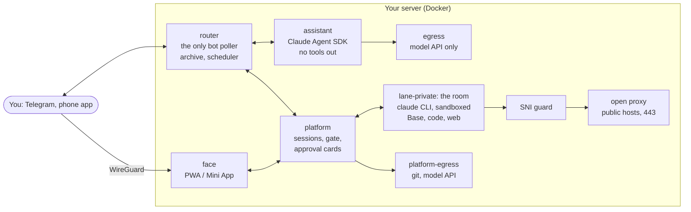

# Retinue

**A personal AI platform on your own server.** One owner, one Linux box. Retinue gives you two things:

- **an assistant that cannot leak.** It lives in Telegram, reads your private data (the conversation archive, your
  mail, your knowledge base) and has no way out but the model API: no web, no shell, no file tools;
- **Claude Code sessions you steer from your phone.** An unmodified, version-pinned `claude` CLI runs headless in a
  sandboxed container on the server, in auto mode. Every tool call passes a gate; what the gate or the CLI's
  classifier will not allow comes to you as an approval card, in Telegram or in the app.

Around them sit optional parts: mail and calendar triage, replies to people that go out only by your button, a
knowledge base the sessions can read and commit to, your code repositories with a push-to-PR card, reminders and a
morning summary, trip search, read-only pages for your devices, backups and health checks.

> **Status: personal pilot.** It runs every day on one server, for one person. It is not a product: there is no
> multi-user mode, no hosted version, and breaking changes land on `main` without notice. Read it, borrow from it,
> run it for yourself if the model below fits you.

## Contents

- [How it works](#how-it-works)
- [Security model](#security-model)
- [Quick start](#quick-start)
- [Documentation](#documentation)
- [Repository layout](#repository-layout)
- [Language: English throughout](#language-english-throughout)
- [Model access](#model-access)
- [Limits and known gaps](#limits-and-known-gaps)
- [Contributing, security, license](#contributing-security-license)

## How it works



- **router** (`retinue/router.py`, `retinue/core.py`) holds the Telegram token, writes both sides of every turn to
  an append-only SQLite archive with full-text search, runs reminders and the morning summary, and routes your
  message: plain text to the assistant, a reply to a session's message to that session.
- **assistant** (`retinue/agent_host.py`, `retinue/engine.py`, `agents/assistant/`) is one long Claude Agent SDK
  session on an internal network. Its tools are the router's (search the archive, set a reminder, fetch an
  attachment, search trips); its config is mounted read-only.
- **platform** (`retinue/platformd.py`, `retinue/gate.py`, `retinue/approvals.py`) starts and drives Claude Code
  sessions, keeps every line of every run in its own SQLite, and answers the gate hook that the CLI calls before
  each tool call. A session can hand separable work to sub-sessions of its own through the platform's MCP server
  (`retinue/subs.py`) and is told when each one's turn ends. The platform holds no bot token and has no route out
  except its own proxy.
- **the room** (`lane-private`, `retinue/lane_host.py`, `deploy/lanes/`) is the one lane container sessions run in:
  your knowledge base (the Base), clones of your repositories and the web through the CLI's `WebFetch` and
  `WebSearch`. Bash is sandboxed and reaches only GitHub and the package registries (with one documented gap,
  see [Limits and known gaps](#limits-and-known-gaps)).
- **face** (`face/`) is a React PWA, also opened from Telegram as a Mini App, reachable only over WireGuard from your
  devices: tabs **Today · Sessions · ＋ · Spaces · Read** (＋ is `/new`, a new task), a live transcript,
  approval cards, a session's diff, the Spaces of the Base, pages to read, and voice input.

Each optional part has its own `setup.sh` switch and its own guide (see [Documentation](#documentation)).

## Security model

The design question is the one every personal agent faces: an agent with your private data, untrusted input and a
way out is one prompt injection away from mailing your life to a stranger. Retinue answers it differently for the
two halves, and enforces both in the system, not in a prompt.

**The assistant: no way out.** Its container sits on an internal network; the only exit is a Squid proxy that lets
through the model API and nothing else. It has no Bash, no file tools and no web tools. Files you send are read by
the router and handed over as text and images. Nothing it writes becomes a link.

**The room: all three of the lethal trifecta, on purpose, with guards.** Sessions in the room read pages and
repositories (untrusted text), see your Base and your code (private data) and can fetch from the web (a way out).
That was a deliberate trade, made when three separate lanes were merged into one. What stands on the
path of a leak:

| Layer | What it does | Where |
|---|---|---|
| Auto mode's classifier | decides every call no rule decides; no rule lets `WebFetch` or `WebSearch` past it | Claude Code |
| The gate | a hook on every tool call; the never list (push, publish, mail, a connection to another machine) is never granted and comes as a courier card for you to run | `retinue/gate.py`, `retinue/approvals.py` |
| The exfil guard | a fetch or search that looks like it carries data comes to you as a card first | `retinue/exfil.py` |
| The SNI guard | Bash's TLS must name the host it asked the proxy for, so an allowed CDN cannot front another site | `retinue/sniguard.py` |
| Egress allow lists | Bash reaches GitHub, PyPI and npm only; the open proxy refuses private ranges | `deploy/egress/`, `deploy/lanes/managed-settings-private.json` |
| Tokens out of reach | the subscription token reaches the CLI through a pipe; no git or registry credential and no bot token enters the room | [docs/platform.md](docs/platform.md#the-token-out-of-reach) |
| Writes by your button | a commit to the Base («To the Base») or a pushed branch with its pull request («Push») is made by the platform after you press, with your rights | [docs/base.md](docs/base.md), [docs/code.md](docs/code.md) |
| The container | non-root user, read-only root, AppArmor and seccomp profiles, no capabilities | `deploy/lanes/`, `deploy/compose.yml` |

None of these is a wall on its own, and the docs say where each one stops: see
[The room](docs/platform.md#the-room) and [Limits and known gaps](#limits-and-known-gaps).

## Quick start

### See the app without a server

The face ships with a mock API that implements its whole contract in memory: sessions, a streamed transcript,
approval and courier cards, a diff. You need Node 24 and pnpm 11.

```bash
pnpm -C face install
pnpm -C face dev
```

Open the login link it prints (`http://127.0.0.1:5173/login#<code>`). More in [face/README.md](face/README.md).

### Run the tests

Python 3.12 and [uv](https://docs.astral.sh/uv/):

```bash
uv run --frozen --with pytest pytest -q
pnpm -C face test
```

### Run it for yourself

You need a Linux server with Docker, a Telegram bot from [@BotFather](https://t.me/BotFather), your Telegram user id
and a Claude subscription token (`claude setup-token`). The full guide is
[docs/install.md](docs/install.md); in short:

```bash
git clone https://github.com/<you>/retinue /opt/retinue
sudo TELEGRAM_OWNER_ID=<your-telegram-id> bash /opt/retinue/deploy/setup.sh
# fill TELEGRAM_BOT_TOKEN and CLAUDE_CODE_OAUTH_TOKEN in /srv/retinue/stack.env, then:
cd /opt/retinue && sudo docker compose -p retinue --env-file /srv/retinue/stack.env -f deploy/compose.yml up -d --build
```

Then send the bot `/check`. Claude Code sessions are one more switch (`PLATFORM=1`,
[docs/platform.md](docs/platform.md#turning-it-on)); the phone app another (`FACE=1`, [docs/face.md](docs/face.md)),
which needs a WireGuard VPN.

## Documentation

| Guide | What |
|---|---|
| [install.md](docs/install.md) | the server, the bot, the stack, the egress allow list, tests |
| [platform.md](docs/platform.md) | Claude Code sessions: tracks, spheres, sub-sessions, the room, the gate, approvals, questions, the courier card |
| [face.md](docs/face.md) | the phone app: WireGuard, login, the shell and its tabs, voice, the face API |
| [base.md](docs/base.md) | the knowledge base as a clone in the room, Spaces, «To the Base» commits |
| [code.md](docs/code.md) | your repositories in the room, mirrors, tokens, the «Push» push-to-PR card |
| [instructions.md](docs/instructions.md) | what a session follows: lane rules, the repository's `CLAUDE.md`, your skills, the owner-memory snapshot |
| [memory.md](docs/memory.md) | the knowledge base the assistant writes, and its hub |
| [mail.md](docs/mail.md) | Gmail and Google Calendar, read-only, and their triage |
| [courier.md](docs/courier.md) | your chosen Telegram chats and replies to people, sent only by your button |
| [proactive.md](docs/proactive.md) | the time zone, deadlines, a tracker with a weekly goal, the heartbeat |
| [pages.md](docs/pages.md) | your HTML pages for your devices, keeping what you do in them; public sites of the ones you share |
| [backup.md](docs/backup.md) | the nightly restic backup and the monthly check from your own computer |
| [health.md](docs/health.md) | the containers checked every two minutes, told to you when one goes bad |

## Repository layout

```
retinue/            the Python package (aiohttp, SQLite): router, assistant host, platform, gate, guards
agents/assistant/   the assistant's agent.yaml (tools, limits) and CLAUDE.md (its instructions)
face/               the phone app: React, Vite, TypeScript; a mock API for development
deploy/             compose.yml, setup.sh, the lane image, egress lists, example configs, systemd units
tests/              the pytest suite; tests/e2e has a compose smoke test
docs/               one guide per part
```

## Language: English throughout

The code, the comments, the docs, the commit messages and everything the owner reads in the product are in English:
the bot's messages, the buttons («Allow», «To the Base», «Push»), the app's tabs, the assistant's and the lanes'
instructions (`agents/assistant/CLAUDE.md`, `deploy/lanes/instructions/`). The docs quote those strings as they are,
in «guillemets», so you can find them in the code and in the app. There is no translation layer: the product has one
user. Where the owner types a command or a reply the code parses (a time zone, `/initiative`, a card's reply), the
Russian form still works alongside the English one. The owner's knowledge base is data and stays in whatever language
it is written in.

## Model access

Today both halves run on Claude: the assistant on the Claude Agent SDK, the sessions on the `claude` CLI. The
assistant's engine sits behind one interface (`retinue/engine.py`), and the platform drives the CLI through
`retinue/cliengine.py`, so another engine has one place to plug in; none is wired up yet.

The deployment runs on your own Claude subscription token (`CLAUDE_CODE_OAUTH_TOKEN` from `claude setup-token`),
for your own personal use; it passes no API key, and the platform refuses a lane that has one in its environment.
Check Anthropic's current terms for your case. Voice
transcription uses [ElevenLabs](https://elevenlabs.io) Scribe and is optional.

## Limits and known gaps

- **One owner.** Every part assumes a single person: one Telegram id, one set of devices, one token.
- **The room can leak by a path the guards do not see.** Plain words under every threshold of the exfil guard pass;
  a CDN that routes by the HTTP `Host` (Fastly does) lets Bash reach other sites through PyPI. Both are written up
  in [docs/platform.md](docs/platform.md#the-room), with what would close them.
- **Tied to Claude today.** See [Model access](#model-access).
- **The Matrix channel** is still in the code and off by default ([docs/install.md](docs/install.md#matrix-optional)).
- **No CI.** Run the tests locally before a pull request.

## Contributing, security, license

- Issues and pull requests are welcome; read [CONTRIBUTING.md](CONTRIBUTING.md) first.
- Found a vulnerability? Do not open a public issue; see [SECURITY.md](SECURITY.md).
- Licensed under [Apache-2.0](LICENSE).
